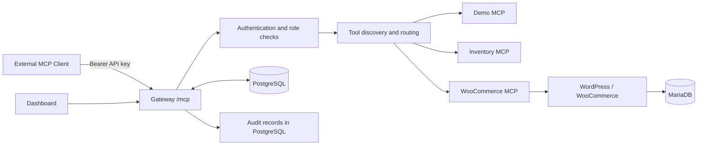

# Urumi MCP Gateway

Urumi MCP Gateway is a TypeScript-based Model Context Protocol (MCP) gateway that provides one authenticated endpoint for multiple upstream MCP servers. It includes a React dashboard, user-level API keys, role-based administration, PostgreSQL audit logging, demo and inventory tools, and a WooCommerce MCP integration. Local deployments can run with Docker Compose or Kubernetes using Helm.

> **Deployment scope:** The repository has been validated against a local Windows/Minikube environment. The production values file is a starting template, not evidence of a live production deployment. See [Deployment](docs/deployment.md) and [Verification notes](docs/verification.md).

## Features

- **One Streamable HTTP endpoint:** `POST /mcp` exposes tools from enabled upstream MCP servers.
- **API-key authentication:** keys are generated from cryptographically secure random data, stored as SHA-256 hashes, and checked for revocation, expiry, and active-user status.
- **Role-based access:** admin-only server-management operations are separated from member tool use.
- **Tool aggregation:** namespaced tool names reduce collisions between servers.
- **Upstream routing and fault handling:** calls are routed to the owning upstream, with timeout and failure handling.
- **Audit logging:** tool calls include the authenticated user, API key reference, server/tool names, outcome, duration, and optional request ID.
- **Dashboard:** React/Vite interface for using the gateway and administering upstream server configuration.
- **Upstreams:** Demo MCP, Inventory MCP (sample data), and WooCommerce MCP.
- **Persistent storage:** PostgreSQL for gateway state and audit data; the Helm chart also deploys WordPress/WooCommerce and MariaDB when the store is enabled.
- **Deployment options:** Docker Compose and a Helm chart for Kubernetes/Minikube.

## Architecture



See [Architecture](docs/architecture.md) for request flows and component responsibilities.

## Technology stack

- Node.js 22+ and TypeScript
- Express and the MCP TypeScript SDK
- PostgreSQL 16
- React and Vite
- Docker / Docker Compose
- Kubernetes, Minikube, and Helm
- WordPress, WooCommerce, and MariaDB for the local store integration
- Vitest and Supertest for automated tests

## Repository structure

```text
apps/
  gateway/                 Gateway API, authentication, chat, MCP routing, audit and migrations
  dashboard/               React/Vite dashboard
servers/
  demo-mcp/                Demonstration tools
  inventory-mcp/           Sample inventory tools
  woocommerce-mcp/         WooCommerce MCP tools
packages/
  shared/                  Shared schemas and types
infra/
  docker/                  Dockerfiles and Nginx configuration
  helm/urumi-gateway/      Kubernetes Helm chart and environment values
docs/
  architecture.md          Component and request-flow documentation
  deployment.md            Windows, Docker Compose, Minikube, and production-template guidance
  verification.md          Observed test evidence and outstanding checks
  threat-model.md          Threats, controls, residual risks, and hardening plan
compose.yaml               Docker Compose deployment
```

## Prerequisites

For local development, install Node.js 22 or newer and npm. For Docker Compose, install Docker Desktop and use Linux containers. For Kubernetes, install Docker Desktop, Minikube, `kubectl`, Helm, and enable the Minikube Ingress add-on.

## Local development

Run commands from the repository root in PowerShell.

Install dependencies:

```powershell
npm install
```

Run type checks, tests, and builds:

```powershell
npm run typecheck
npm run test
npm run build
```

The root package scripts run the corresponding workspace scripts where available. If a workspace lacks one of these scripts, npm may skip it depending on the script definition.

## Run with Docker Compose

Start the services:

```powershell
docker compose up -d --build
docker compose ps
```

Configured local endpoints:

| Component | URL |
|---|---|
| Dashboard | `http://127.0.0.1:15173/` |
| Gateway health | `http://127.0.0.1:14000/health` |
| Gateway readiness | `http://127.0.0.1:14000/health/ready` |
| MCP endpoint | `http://127.0.0.1:14000/mcp` |

Stop services without removing persistent volumes:

```powershell
docker compose stop
```

Use `docker compose down` only when you intend to remove the containers/network. Do not add `-v` unless you explicitly intend to delete Compose-managed volumes and their data.

## Local Kubernetes / Minikube

The local Helm chart is at `infra/helm/urumi-gateway`. The default values configure the Ingress host `urumi.local` and store host `store.urumi.local`.

Check the current cluster and release before applying changes:

```powershell
minikube status
kubectl get pods
kubectl get services
kubectl get ingress
helm list -n default
helm status urumi-gateway -n default
```

The current local setup uses an NGINX Ingress port-forward. In one terminal, keep this running:

```powershell
kubectl port-forward --address 127.0.0.1 -n ingress-nginx svc/ingress-nginx-controller 8080:80
```

If required, add the following entries to the Windows hosts file (`C:\Windows\System32\drivers\etc\hosts`) with administrator privileges:

```text
127.0.0.1 urumi.local
127.0.0.1 store.urumi.local
```

Then test from another terminal:

```powershell
Invoke-WebRequest -UseBasicParsing -Uri "http://urumi.local:8080/health"
Invoke-WebRequest -UseBasicParsing -Uri "http://urumi.local:8080/health/ready"
```

The corresponding local URLs are `http://urumi.local:8080/` for the dashboard, `http://store.urumi.local:8080/` for the store, and `http://urumi.local:8080/mcp` for MCP clients while the port-forward is running. See [Deployment](docs/deployment.md) before installing or upgrading a release.

## Gateway API

| Endpoint | Purpose |
|---|---|
| `GET /health` | Process health check |
| `GET /health/ready` | Readiness check, including database connectivity |
| `POST /mcp` | Unified Streamable HTTP MCP endpoint |
| `GET /api/audit-logs` | Recent audit events visible to the authenticated user; admins can view all events while members see their own |
| `POST /api/servers/:id/mcp` | Per-server MCP proxy endpoint |

For protected endpoints, pass the API key as a bearer token:

```text
Authorization: Bearer <API_KEY>
```

For JSON-RPC POST requests to `/mcp`, an MCP client should send an `Accept` header that includes both `application/json` and `text/event-stream`, for example:

```text
Accept: application/json, text/event-stream
```

The gateway uses stateless Streamable HTTP. MCP tool names contain a normalized server name and server-ID prefix, followed by `__` and the upstream tool name; therefore, the exact exposed tool name may differ across deployments. Always use the name returned by `tools/list`.

### Create an API key from the CLI

The CLI script creates a key for an active administrator using the configured database connection and the `ADMIN_EMAIL` configuration:

```powershell
npm run create-api-key --workspace=@urumi/gateway
```

The raw key is displayed once. Save it securely. Only its hash is stored in PostgreSQL. Do not paste keys into screenshots, issue trackers, logs, or Git commits.

## WooCommerce and inventory scope

The WooCommerce upstream exposes product and order operations, including product search/list/get/create, category listing, order listing/get, and order-status updates. Exact availability depends on the registered upstream's current tool catalog and health. Product creation and order-status updates change store data; validate those separately and use clearly marked test records.

The Inventory MCP server uses **sample data**, not a live warehouse inventory system.

## Security notes

- Keep `.env`, API keys, passwords, database credentials, and Kubernetes Secret values out of source control.
- `values.yaml` references existing Kubernetes Secrets; provide required secrets to the cluster through a secure local process rather than committing secret values.
- API keys should be revoked when no longer needed.
- Use HTTPS, configured TLS, restricted Kubernetes RBAC, network controls, backups, and centralized logging before public production use.
- Read [Threat model](docs/threat-model.md) for threat scenarios and residual risks.

## Verification status

The current local validation session confirmed that a member key could list 13 tools across the three configured upstreams, successfully call the Demo status tool, and retrieve an audit record for that call. The audit event included the member account, exact tool name, successful outcome, request ID, and execution duration. Earlier manual test notes also record successful Inventory and WooCommerce list operations and rejection of a revoked key. The recent WooCommerce retest was interrupted because the local gateway port-forward was no longer reachable; see [Verification](docs/verification.md) for the precise evidence and items to rerun.

## Known limitations and production-readiness notes

- The local Kubernetes environment has shown historical pod restarts, especially among database/store workloads. Recheck logs and readiness before a demonstration.
- `values-prod.yaml` contains placeholder release tags and hostnames. Replace them before use, and ensure the images exist in a registry the cluster can pull from.
- The current chart's Ingress template does not configure a TLS secret. Configure TLS in the Ingress/controller or adapt the chart before exposing the deployment publicly; an HTTPS store scheme by itself does not enable TLS termination.
- A successful local deployment does not demonstrate production availability, backup/restore, scaling, or security hardening.
- Test mutations such as product creation and order-status changes in a test store, and do not describe them as fully validated until their end-to-end results are recorded.
- The current acceptance evidence does not establish that every upstream-pod-failure scenario or the full LLM chat workflow has been validated end to end.

## Automated checks

```powershell
npm run typecheck
npm run test
npm run build
```

See [Verification](docs/verification.md) for which manual checks have evidence and which remain pending.
