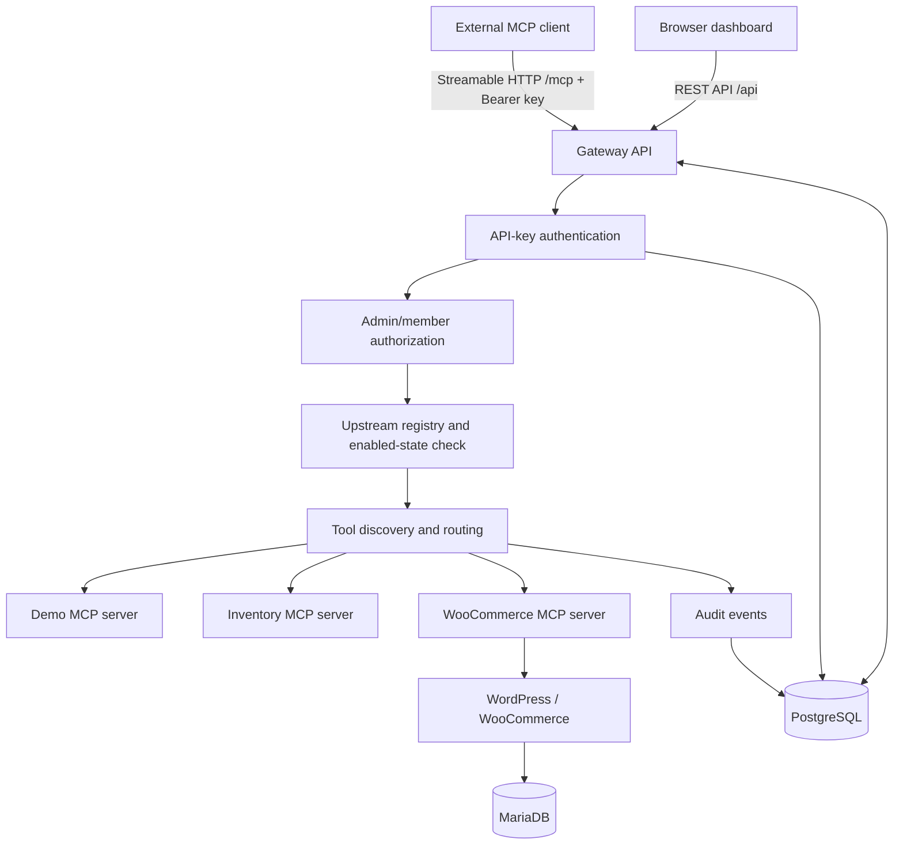

# Architecture

## Overview

Urumi MCP Gateway centralizes authentication, upstream MCP registration, tool discovery, tool routing, and audit logging. MCP clients connect to the gateway instead of configuring each upstream independently. The dashboard uses the gateway's protected REST API and provides the administrative UI and user-facing workflows.

## Components

### Gateway API

The Express/TypeScript gateway is the public application entry point. It provides health/readiness endpoints, protected REST routes, API-key authentication, role enforcement, upstream management, the unified MCP endpoint, and audit logging. The default local gateway port is `4000`; the unified MCP route is `/mcp`.

### API keys and roles

Each API key is generated using cryptographically secure random bytes. The database stores the key hash rather than the raw key. Authentication verifies the hash, revocation time, expiry, and whether the associated user is active. Administrative server-management routes require the admin role; members use permitted tool and audit functionality subject to their identity and policy.

### Unified MCP endpoint

A client posts JSON-RPC/MCP requests to `/mcp`. For Streamable HTTP requests, the `Accept` header must include both `application/json` and `text/event-stream`. The gateway discovers tools from enabled upstream servers and exposes namespaced tool names that include a normalized server name and server-ID prefix. The client should always call `tools/list` and use its exact returned names rather than hard-coding names across environments.

The observed local catalog contained 13 tools: two from Demo MCP, three from Inventory MCP, and eight from WooCommerce MCP. The active catalog can change when an upstream is disabled, unavailable, or its tools change.

### Upstream MCP servers

- **Demo MCP:** simple demonstration tools including status and echo.
- **Inventory MCP:** sample inventory search, stock, and listing tools. These are demo data, not a live warehouse feed.
- **WooCommerce MCP:** product and order tools that use the configured WordPress/WooCommerce store. Operations such as creating a product or changing an order status mutate store data and should be tested with designated test records.

### Dashboard

The React/Vite dashboard calls the gateway API using a configured gateway URL. The dashboard can display upstream management and audit information according to the authenticated role. The API remains responsible for enforcing permissions; UI hiding alone is not an authorization boundary.

### Persistence

PostgreSQL stores users, API-key hashes/metadata, upstream configuration, and audit records. In the local Kubernetes deployment, the Helm chart configures a PostgreSQL persistent volume claim. When the store is enabled, WordPress and MariaDB have separate persistent storage. A PVC protects against ordinary pod replacement but is not a backup strategy.

## Primary request flows

### Tool discovery

1. The client posts the MCP `tools/list` request to `/mcp` with its Bearer API key and the required `Accept` header.
2. The gateway authenticates the key and resolves the user role.
3. The gateway gathers tools from enabled upstream servers and namespaces names to reduce collisions.
4. The gateway returns the merged tool catalog.

### Tool invocation

1. The client sends `tools/call` with an exposed tool name and arguments.
2. The gateway authenticates the client, resolves the exposed tool binding, and verifies that the corresponding upstream is still available/enabled.
3. The gateway forwards the call to the owning upstream and applies timeout/failure handling.
4. The gateway returns the tool result or a controlled error.
5. An audit event records the user ID, API-key ID, upstream server, exposed and upstream tool names, outcome, duration, and the `X-Request-ID` when supplied.

### Audit visibility

The audit API scopes records to the authenticated member; admin users can review events across users. A request ID supplied by the client is useful for correlating the client request with its audit event. Without an `X-Request-ID` header, the audit record's request ID may be null.

### Upstream failure isolation

The gateway checks upstream configuration and enabled status when routing calls and handles upstream failures with controlled errors. The expected acceptance behavior is that one failed upstream does not prevent unrelated upstreams from serving tools. Validate that behavior against the active cluster before claiming pod-failure isolation as passed; a tool catalog test alone does not prove it.

## Deployment topology

Local deployment options:

- Docker Compose with configured dashboard and gateway ports.
- Kubernetes via Minikube and the Helm chart at `infra/helm/urumi-gateway`, including gateway, dashboard, PostgreSQL, upstream MCP servers, and (when enabled) WordPress/WooCommerce plus MariaDB.

The chart's production values file is a template. The current Ingress template does not configure a TLS secret. A public deployment therefore requires explicit TLS configuration and verification in addition to replacing example hosts/tags and provisioning secrets.

## Key design choices and trade-offs

| Choice | Benefit | Trade-off / remaining concern |
|---|---|---|
| One gateway endpoint | Simplifies client configuration and centralizes auth/audit | The gateway becomes a dependency for all calls; it must be monitored and sized correctly. |
| Hashed personal API keys | Raw keys are not stored in the database; keys can be revoked | A stolen active key can still be used until revoked or expired. |
| Namespaced tool names | Reduces cross-upstream name collisions | Names include deployment-specific server-ID prefixes and should be discovered dynamically. |
| PostgreSQL audit records | Gives per-user accountability and request correlation | Requires access control, retention decisions, backups, and integrity protection in production. |
| Helm values for environments | Separates much environment configuration from templates | Image tags, secrets, storage classes, networking, and TLS still require environment-specific provisioning and validation. |
| Local sample Inventory MCP | Makes demonstrations reproducible | It is not evidence of integration with a real warehouse system. |

## Operational limits

- `values-prod.yaml` is not proof of a public production deployment.
- The current chart Ingress does not define TLS termination.
- Recent local acceptance evidence verifies member discovery, a successful Demo tool call, and the corresponding audit event. Upstream-pod kill scenarios and the complete LLM chat workflow still require explicit end-to-end evidence.
- Local cluster restarts and probe warnings should be resolved before production claims are made.
